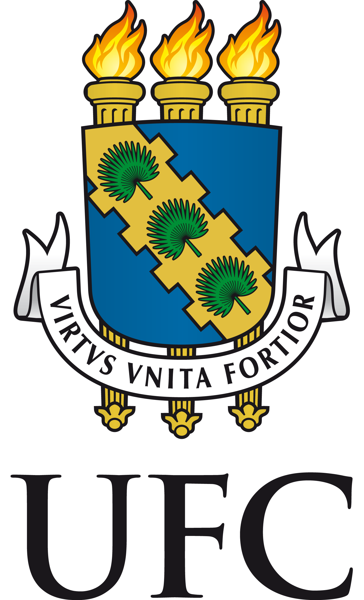

<!DOCTYPE html>
<html lang="en">
<head>
    <meta charset="UTF-8">
    <meta name="viewport" content="width=device-width, initial-scale=1.0">
    <title>IntegraMec - Interdisciplinaridade da Engenharia Mecânica</title>
    <link rel="stylesheet" href="css/style.css">
    <link href="https://fonts.googleapis.com/css2?family=Playfair+Display:wght@400;500;600;700&family=Outfit:wght@300;400;500;600;700&display=swap" rel="stylesheet">
</head>
<body>
    <!-- Header -->
    <header class="header">
        

            

                

                    
                    <h1>INTEGRAMEC</h1>
                

                <nav class="nav">
                    <a href="https://iury-caua.github.io/pages/estrutturacurricularmec.pdf" target="_blank">Estrutura Curricular</a>
                    <a href="https://iury-caua.github.io/pages/cidade-interativa.html" target="_blank">Realidade Virtual</a>
                    <a href="https://iury-caua.github.io/pages/participantes.html" target="_blank">Participantes</a>
                    <a href="#reviews">Opiniões</a>
                    <a href="#contact">Contato</a>
                </nav>
                

                    <button class="menu-toggle" id="menuToggle" aria-label="Menu">&#9776;</button>
                

            

        

    </header>
    <!-- Mobile Nav -->
    

        <button class="mobile-nav-close" id="mobileNavClose">&times;</button>
        <a href="https://iury-caua.github.io/pages/estrutturacurricularmec.pdf" target="_blank">Estrutura Curricular</a>
        <a href="https://iury-caua.github.io/pages/cidade-interativa.html" target="_blank">Realidade Virtual</a>
        <a href="https://iury-caua.github.io/pages/participantes.html" target="_blank">Participantes</a>
        <a href="#reviews">Opiniões</a>
        <a href="#contact">Contato</a>
    

    <!-- Hero -->
    <section class="hero">
        

        

        

            

                Mecânica em Conexão.
                <h2>O motor da inovação é  multidisciplinar.</h2>
                
Muito além das engrenagens: A interdisciplinaridade moldando o engenheiro mecânico na UFC.

                

                    <a href="https://iury-caua.github.io/pages/cidade-interativa.html" class="btn btn-primary">Realidade Virtual</a>
                    <a href="#reviews" class="btn btn-glass">Avaliar</a>
                

            

        

    </section>
    <!-- Footer -->
    <footer class="footer">
        

            

                

                    

                        
                        <h3>INTEGRAMEC</h3>
                    

                    
Mais que calcular forças, conectar ideias: A interdisciplinaridade na Mecânica da UFC.

                    

                        <a href="#">Ig</a>
                        <a href="#">Fb</a>
                        <a href="#">Yt</a>
                        <a href="#">Pi</a>
                    

                

                

                    <h4>Estrutura Curricular</h4>
                    <a href="https://iury-caua.github.io/pages/estrutturacurricularmec.pdf" target="_blank">Eng. Mecânica</a>
                    <a href="#">Eng. Telecomunicações</a>
                    <a href="#">Eng. Produção</a>
                

                

                    <h4>Participantes</h4>
                    <a href="#">Orientador</a>
                    <a href="#">Colaboradores</a>
                    <a href="#">Voluntários</a>
                    <a href="#">Bolsistas</a>
                

                

                    <h4>Contato</h4>
                    <a href="#">Whatsapp</a>
                    <a href="#">Instagram</a>
                    <a href="#">Email</a>
                    <a href="#">Telegram</a>
                

            

            

                
&copy; 2026 IntegraMec. Todos os direitos reservados.

                

                    <a href="#">Privacidade</a>
                    <a href="#">Termos</a>
                    <a href="#">Cookies</a>
                

            

        

    </footer>
    <!-- Back to Top -->
    <button class="back-to-top" id="backToTop" aria-label="Back to top">&#8593;</button>
    
</body>
</html>
